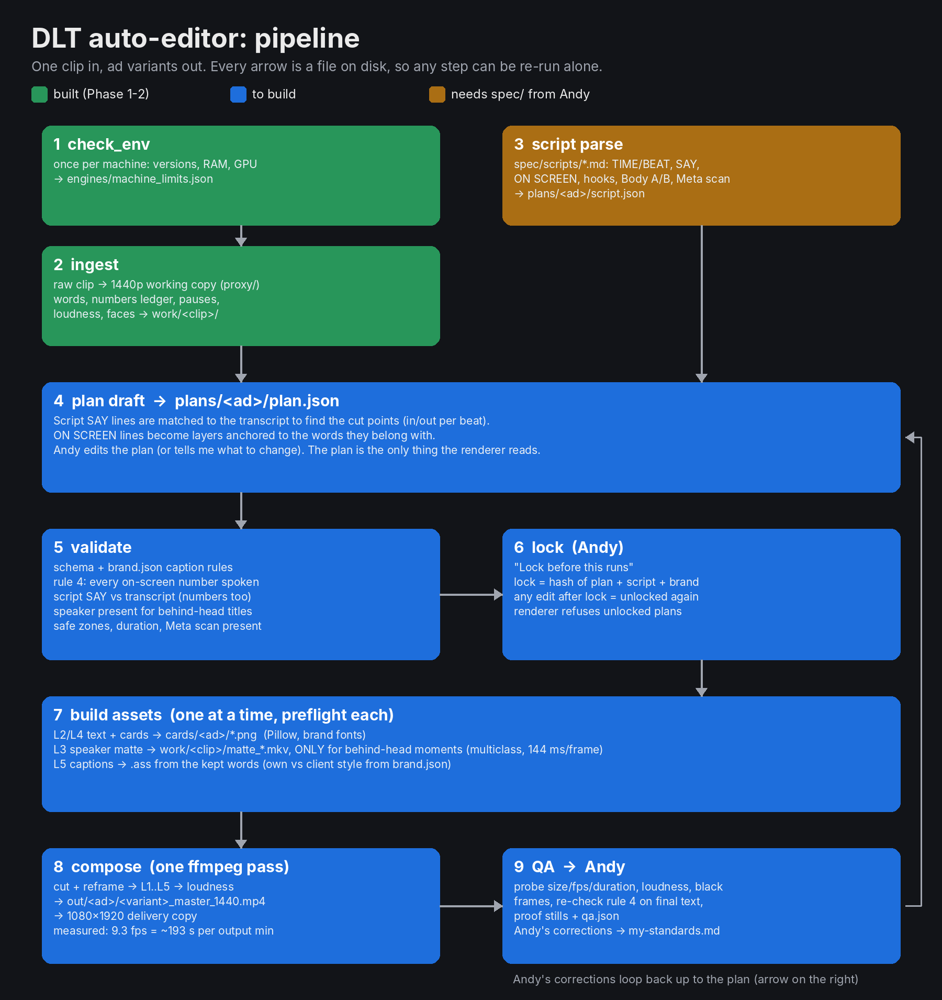
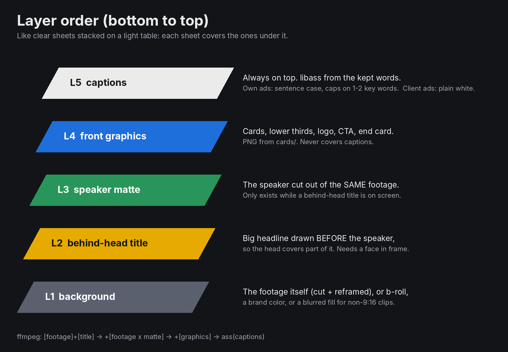

# DLT auto-editor: architecture (Phase 3 proposal)

Status: **proposal, waiting for Andy's approval.** Nothing below is built yet except stages 1 and 2.
`spec/SOP-DLT-1-v2-video-standard.md` has not been provided yet. Anything marked *pending SOP* is a placeholder the SOP will override.

## The big idea in one line

The editor works like a **recipe card and a kitchen**: `plan.json` is the recipe (what to cut, what text goes where, when), the engines are the kitchen (they follow the recipe exactly). You only ever check and change the recipe. Same recipe in = same video out, every time.

## Pipeline

| # | Stage | In | Out | Status |
|---|-------|----|-----|--------|
| 1 | check_env | the machine | `engines/machine_limits.json` | built |
| 2 | ingest | `raw/<clip>` | 1440p `proxy/`, `work/<clip>/` words, numbers ledger, pauses, loudness, faces | built |
| 3 | script parse | `spec/scripts/*.md` | `plans/<ad>/script.json` | needs spec/ |
| 4 | plan draft | script.json + ingest | `plans/<ad>/plan.json` | to build |
| 5 | validate | plan + ingest + brand.json | `checks` filled in | to build |
| 6 | lock (Andy) | validated plan | `lock.hash` | to build |
| 7 | build assets | locked plan | `cards/<ad>/*.png`, mattes, `.ass` captions | to build |
| 8 | compose | assets + proxy | `out/<ad>/<variant>_master_1440.mp4` + 1080x1920 delivery | to build |
| 9 | QA | output | `qa.json`, proof stills, Andy's review | to build |

Each arrow is a file on disk, so any stage can be re-run on its own (change a title, re-run 7-9, no re-transcribing). Every render stage goes through `preflight.render_slot()`: one render at a time, RAM and disk checked first.

## Layer order (bottom to top)

| Layer | What | Made by |
|-------|------|---------|
| L1 background | the footage, cut and reframed (or b-roll / brand color / blurred fill for non-9:16) | ffmpeg |
| L2 behind-head title | big headline drawn *before* the speaker | Pillow PNG |
| L3 speaker matte | the speaker cut out of the same footage, laid back on top, so the head covers the title | MediaPipe -> lossless matte video |
| L4 front graphics | lower thirds, CTA, logo, end card | Pillow PNG / `cards/` |
| L5 captions | always on top | libass |

In ffmpeg it is one pass: `footage + title -> + (footage x matte) -> + graphics -> captions`.

**Proven in Phase 3** on a 1440x2560 test clip (`engines/spike_layers.py`, stills in `out/phase3-proof/`):

| Measured | Value |
|----------|-------|
| Full 5-layer render | 9.3 fps = **~193 s per minute** of 1440p output, 1.19 GB peak RAM |
| Matte, multiclass model (clean hair edges) | **144 ms/frame** end to end |
| Matte, selfie model (white halo around hair) | 24.6 ms/frame |
| Matte stored as | 720x1280 lossless (FFV1), scaled up inside the render: 6.8 MB per 6 s |

**Decision: use the multiclass matte, and only build it while a behind-head title is on screen.** A 3-second hook title costs about 13 s of matte work; matting a whole 60 s ad would cost about 4.3 minutes for nothing.

## plan.json

Schema: `plans/plan.schema.json` (machine-checked). Full example: `plans/example.plan.json`.
Tests: `python3 -m unittest engines/test_plan_schema.py`.

One plan = one ad with all of its variants. The main sections:

| Section | Plain English |
|---------|---------------|
| `ad_type` | `own` (DLT's ad: sentence case, caps on 1-2 key words) or `client` (plain white captions). Captions follow this automatically. |
| `sources` | the raw clips used, and where their ingest results are. |
| `parts` | the cut list. Each part = one piece of one clip (`in`/`out` in that clip's seconds), tagged with its script `beat` and `say` line, plus how to frame it (`reframe`) and optional `broll` that covers the picture while the voice keeps going. |
| `group` on a part | `hook:H1`, `body:A`, `cta`, `shared`. This is how hook alternates and Body A/B from the script live in one plan. |
| `variants` | which hook + body to combine, e.g. `H1-A`, `H2-B`. Each variant plays its parts in listed order. |
| `layers.titles` | L2 behind-head titles. Each one automatically gets an L3 matte. |
| `layers.graphics` | L4 front graphics (text, image, card, end card) with a position box in % of the frame. |
| `layers.captions` | L5 style, which words get CAPS (`emphasis`), and `fixes` for misheard words. |
| `status` / `lock` | `draft` until Andy locks it. The lock is a fingerprint (hash) of plan + script + brand.json; any edit afterwards breaks it and the renderer refuses to run. This is "Lock before this runs". |
| `checks` | filled in by the validator, never by hand. |

### Why anchors instead of seconds

Text never says "show at 3.2 s". It says **"show at word a:61"** (word 61 of clip a's transcript) or "at the end of part cta". Like pinning a sticky note to a word instead of to a clock: if the cut moves, the note moves with its word. If an anchored word gets cut out, validation fails instead of putting text in the wrong place. The schema rejects plain-seconds times outright.

### How rule 4 is built in

- Every on-screen `text` (titles and graphics) is checked against the spoken-numbers ledger of the words that are actually *kept* in that variant. A number spoken only in Body A cannot appear in a Body B variant.
- A caption `fix` that changes a number ("255" -> "250") changes the ledger too, so it must say who heard it (`heard_by`). The schema rejects a fix without it.
- Each part's `say` line is diffed against the transcript, numbers included. This catches the Phase 2 "255 vs 250" case before anything renders.
- QA re-checks the final text after render.

Preview on the example: "Text back in under 5 min" passes (spoken: "five minutes"); "Book a 15-min call" passes (spoken: "fifteen minute").

### Things the schema refuses (tested)

A hex color in a plan (brand values only in brand.json), raw-seconds anchors, misspelled keys (`untill`), a text graphic with no text, an unknown group like `hooks:H1`, a hand-written lock, a caption number fix with no `heard_by`.

## Built since Phase 3 (where each piece lives)

| Phase | What | Code | Numbers |
|------|------|------|---------|
| 7 | Depth look: refined person matte, title on a brand slab behind the head, rise + drift | `engines/depth.py`, proof `engines/phase7_depth.py` | `sop-defaults.json depth_sop_7` |
| 8 | Synth music bed + soft effects on the edit's clock: silent in the hook and guarantee, ducked under words, settle-in after the hook, fade-out on the logo card | `engines/music.py` | `music_sop_5` |
| 9 | QA gate (BLOCK / HOLD / PASS) + policy scan | `engines/qa_gate.py`, `engines/policy_scan.py` | `spec/policy-rules.json` -> `spec/QA-policy.md` |
| 10 | Client cards (`clients/<id>/card.json`, codes C01-C10), intake check (codes I01-I13), hook-matrix export (`<Ad>_H<n>_Body<x>_v<k>.mp4`) | `engines/client_card.py`, `engines/intake.py`, `engines/export_matrix.py` | `clients/card.schema.json`, `spec/intake-rules.json` |

Order for one ad: `intake.py` -> `ingest.py` -> `build_plan.py` -> `render.py --draft` -> `qa_gate.py` -> (Andy locks / accepts) -> `render.py` -> `qa_gate.py` -> `export_matrix.py`.

Hook matrix: a script with a hooks table (H1..Hn, e.g. `spec/scripts/starting-out-40s.md`) gives one variant per recorded hook x body (`H3_A`, `H3_C2`, ...); each cut opens on its own hook only. A hook with no take gets no cut and shows in lock check `hooks_recorded`; it never blocks the others. Export names use the script's hook number, so H3 stays H3 even if H2 was never filmed.

The timeline is whole frames: every piece is trimmed to an exact frame count (video) and the matching sample count (audio), so the planned clock that places titles, graphics, captions, ticks and music is the file's clock (render QA `timeline_exact`).

## Pending SOP / pending Andy

| Item | Placeholder now |
|------|-----------------|
| Caption size, position, words per line | brand.json `_placeholder` values |
| Meta safe zones (UI covers top/bottom/right) | not enforced yet |
| Loudness target | `audio_sop_5`: -14 LUFS / -1 dBTP (plan `audio.loudness_lufs` null = this) |
| Music | `music_sop_5` (plan `audio.music`: null = on, "off" = none) |
| Max duration per placement | `output.max_duration_s: null` |
| Brand colors and fonts | `null` (Inter fallback) |
| Script format details | parser waits for `spec/scripts/` |
| Sources below 1440p | kept native, no upscale (Andy to confirm) |

Node is not used by the engine. It is kept for a later review screen (preview a plan, click to adjust) if wanted.
